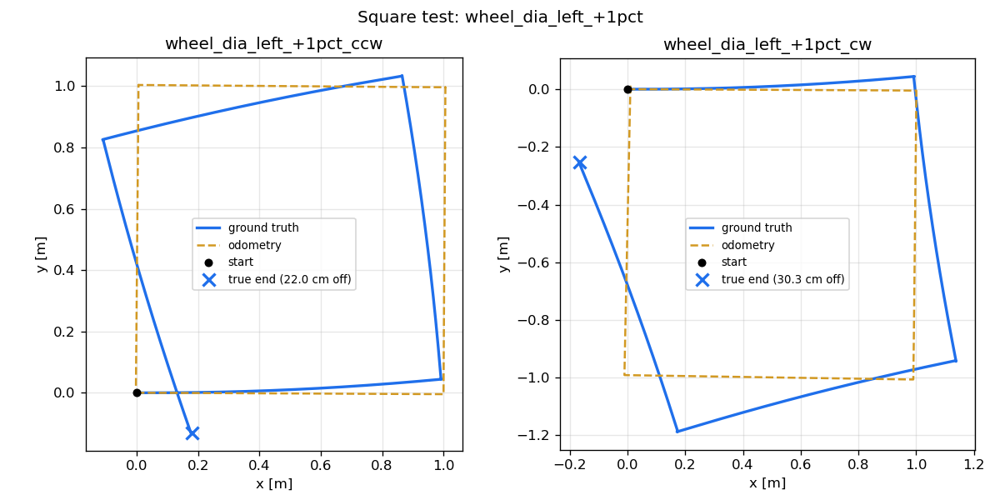
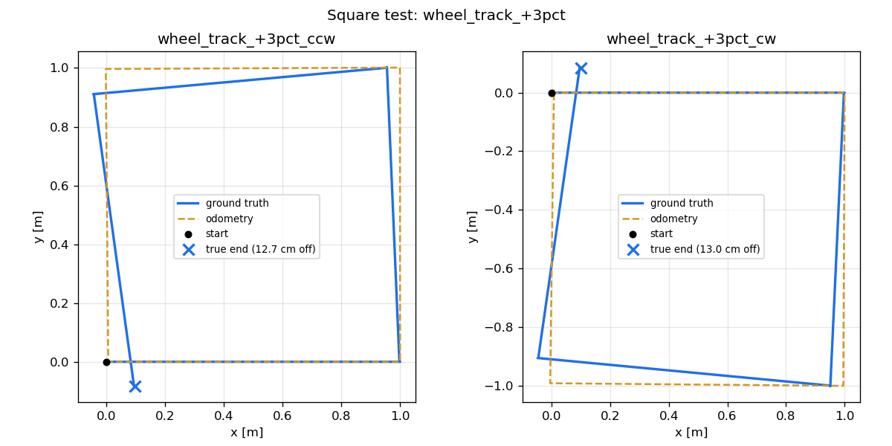
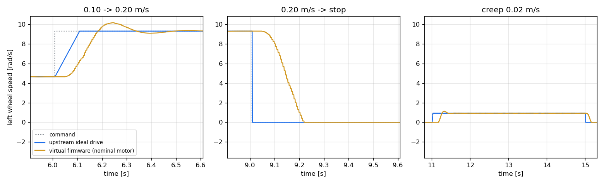
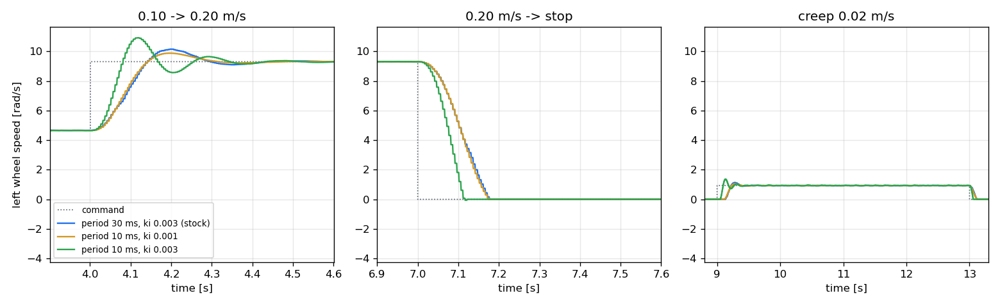

# makerspet-bld120

Simulation realism, benchmarked autonomy and a patrol application for the
**Maker's Pet BLD-120MM** LiDAR robot, built on top of the open-source
[Kaia.ai](https://github.com/kaiaai) / [Maker's Pet](https://github.com/makerspet)
ROS 2 platform.

> **Credit.** The robot hardware, firmware and the base ROS 2 stack (bringup,
> telemetry, teleop, Gazebo world, Nav2 configuration) are the work of the
> Kaia.ai / Maker's Pet authors. This repository does **not** modify or vendor
> any of it; it adds new packages that run alongside the upstream ones. The
> build itself is documented in the official
> [BLD-120MM build guide](https://makerspet.com/blog/bld-120mm-pack/).
> See [NOTICE](NOTICE) for attribution details.

**Status:** work in progress. See the [roadmap](#roadmap).

---

## The robot

The BLD-120MM kit is a ~12 cm differential-drive robot. In the Kaia.ai software
it is described by the **`makerspet_mini`** robot-description package, which is
why every upstream command below uses `robot_model:=makerspet_mini`.

| Component  | Part |
|------------|------|
| MCU        | ESP32 DevKit v1 on a BDC-30P driver board, Kaia.ai firmware (Arduino) |
| LiDAR      | LDROBOT LD14P (360°, 2D) |
| Drive      | 2 × 12 V N20 gear motors with quadrature encoders (1035 PPR) |
| Power      | 2 × 18650 Li-ion (upstream default is 6 × AA; the 18650 pack is a mod the build guide flags as at-your-own-risk) |
| Link to PC | Wi-Fi (2.4 GHz) → micro-ROS agent on the ROS 2 PC |
| IMU        | none: odometry comes from the wheel encoders only |

---

## Part 1: Upstream baseline

This is the setup the rest of the repo builds on. It is a short summary in my
own words of what I ran; the authoritative, illustrated instructions
(assembly, firmware flashing, Wi-Fi provisioning) are in the
[build guide](https://makerspet.com/blog/bld-120mm-pack/) and the
[`kaiaai`](https://github.com/kaiaai) repositories.

**Platform:** Ubuntu 24.04, ROS 2 Jazzy, Gazebo Harmonic, native install (no Docker).

1. **Build the robot and flash the firmware.** Follow the build guide. The
   firmware is the Kaia.ai ESP32 firmware (tested here with release `v0.8.4`,
   board config `config_mini_bdc_30p.yaml`), flashed from the Arduino IDE.
   Robot and network settings are entered through the robot's Wi-Fi setup page.
2. **Build the upstream ROS 2 packages** into an underlay workspace. The exact
   commits this repo is tested against are pinned in [`upstream.repos`](upstream.repos):
   ```bash
   mkdir -p ~/ros_ws/src && cd ~/ros_ws
   vcs import src < /path/to/makerspet-bld120/upstream.repos
   source /opt/ros/jazzy/setup.bash
   rosdep install --from-paths src --ignore-src -y
   colcon build --symlink-install
   source install/setup.bash
   ```
3. **Connect the robot and drive it manually** (one terminal each):
   ```bash
   ros2 launch kaiaai_bringup physical.launch.py robot_model:=makerspet_mini
   ros2 launch kaiaai_bringup monitor_robot.launch.py robot_model:=makerspet_mini
   ros2 run kaiaai_teleop teleop_keyboard robot_model:=makerspet_mini
   ```
4. **Map, then navigate** (upstream autonomy, unchanged):
   ```bash
   ros2 launch kaiaai_bringup cartographer.launch.py robot_model:=makerspet_mini
   ros2 run nav2_map_server map_saver_cli -f ~/maps/home
   ros2 launch kaiaai_bringup navigation.launch.py robot_model:=makerspet_mini map:=$HOME/maps/home.yaml
   ```
5. **Simulation** (upstream Gazebo world; see Part 2 for this repo's version):
   ```bash
   ros2 launch kaiaai_gazebo world.launch.py robot_model:=makerspet_mini
   ```

Steps 3 and 4 were verified end to end on my robot (manual driving, a
Cartographer map of my apartment, Nav2 goals reached) on 2026-10-12. Practical
notes I ran into are collected in [docs/UPSTREAM.md](docs/UPSTREAM.md).

---

## Part 2: What this repo adds

| Area | Upstream | This repo |
|------|----------|-----------|
| Sim odometry | Ground-truth pose published as odometry: no drift | Odometry integrated from simulated 1035-PPR encoders with calibration error and slip |
| Sim actuation | Ideal velocity drive with an acceleration cap | "Virtual firmware": N20 motor model + the ESP32 wheel PID loop |
| Sim parameters | Estimated masses and nominal geometry | Fitted to logged data from the real robot (system identification) |
| Navigation | Default Nav2 (NavFn + DWB), untuned for this size | Benchmarked controllers/planners; tuned config backed by data |
| Controller | Nav2 built-ins | Custom Lyapunov-based path-tracking controller plugin |
| Application | Manual goals in RViz | Waypoint patrol with retries and return-to-home |

Each row is filled in by a milestone below; results and plots are added as they land.

### Simulated odometry that drifts like the real one (`bld120_sim`, M1)

The real robot computes odometry on the ESP32 from its wheel encoders and the
PC only republishes it. Upstream's simulation instead publishes the robot's
true pose as `/odom`, so in simulation odometry never drifts and anything
tested there (mapping, localization, navigation) looks better than it will on
the robot.

`bld120_sim` keeps upstream's robot model and worlds, but at launch it
reroutes Gazebo's true pose to `/ground_truth/odom` and produces `/odom` the
way the firmware does:

| Firmware (v0.8.4, `calcOdometry`) | `encoder_odometry` node |
|---|---|
| Quadrature encoders, 1035 PPR × 4 edges | True wheel angle quantized to 4140 ticks/rev |
| Telemetry every 50 ms | 20 Hz integration on simulation time |
| Midpoint (2nd-order) Euler step, `float32` | Same step, ported line by line, in `float32` |
| Wheel diameter / track from `config.yaml` | Same values, plus optional calibration errors and random slip |

```bash
ros2 launch bld120_sim sim.launch.py                       # GUI, upstream living room
ros2 launch bld120_sim sim.launch.py err_left_pct:=1.0     # firmware thinks the left wheel is 1 % larger
ros2 launch bld120_sim square_test.launch.py direction:=cw output:=~/runs/cw.csv
ros2 run bld120_sim analyze_square ~/runs/*.csv --out ~/runs
scripts/odometry_experiment.sh                             # the full experiment below
```

**Experiment.** A 1 m square driven in both directions, steering only on
`/odom` (leg length, heading and turns), as in the UMBmark test (Borenstein &
Feng, 1996). If odometry were perfect, the robot would return to its start.
Flat world, 0.1 m/s, 0.5 rad/s; the upstream simulation scores exactly 0 on
every row by construction.

| Error source | Direction | True return error | Odometry yaw error at end |
|---|---|---|---|
| None (quantization + simulated physics only) | CCW / CW | 0.1 / 0.5 cm | +1.0° / −1.0° |
| Firmware left wheel diameter +1 % | CCW / CW | 22.0 / 30.3 cm | −19.2° / −24.8° |
| Firmware wheel track +3 % | CCW / CW | 12.7 / 13.0 cm | −9.9° / +9.9° |
| Random slip, 2 % per step (seed 7) | CCW / CW | 6.9 / 7.6 cm | −4.5° / −6.6° |

Repeating a run gives the same numbers to within a few millimetres and about
0.05° (physics and timer scheduling are not bit-exact); for example, a repeat of
the ideal CCW run returned 0.4 cm / +1.0°, and of the +1 % wheel run 21.9 cm / −19.2°.

The two systematic errors leave the classic UMBmark signatures, which is what
lets them be told apart (and later, in M4, measured on the real robot):

* **Unequal wheel diameters** curve every straight leg the same way, so the
  yaw error has the *same sign* in both directions.
* **Wrong wheel track** mis-scales every turn (3 % of 360° ≈ 10.8°, measured
  9.9°), so the yaw error *flips sign* with direction.
* Even with no injected error, the simulated wheels skid slightly during
  in-place turns, an effective-track error of about ±1° per square.

| Wheel diameter error | Track error |
|---|---|
|  |  |

All plots and per-run numbers: [`docs/results/m1_odometry/`](docs/results/m1_odometry/).
They were produced with upstream's ideal drive (`motor_model:=false`, see M2).

### Virtual firmware: wheel PID and motor dynamics (`bld120_sim`, M2)

In upstream's simulation, Gazebo's diff-drive plugin turns `cmd_vel` straight
into wheel speeds: acceleration is capped at 1 m/s², but stops and turns are
instantaneous, and there is no motor, PWM or wheel controller. On the robot,
`cmd_vel` goes through the ESP32 firmware first. The `virtual_firmware` node
(on by default, `motor_model:=false` turns it off) runs that chain in
simulation:

| Stage | Firmware v0.8.4 | `virtual_firmware` |
|---|---|---|
| Command | `cmd_vel` → wheel RPM, both scaled down if one exceeds 180 RPM | Same |
| Ramp | Linear, `base.wheel.accel.max` = 2 m/s² | Same |
| Wheel controller | PI on encoder-measured RPM (`kp` 0.001, `ki` 0.003 per RPM), every 30 ms, *or on every loop pass while the target changes*; integral clamped; PWM duty ±1; duty 0 = brake | Same behaviour; the PI law is written from its equations ([`docs/WHEEL_CONTROLLER.md`](docs/WHEEL_CONTROLLER.md)); ~2 ms main loop |
| Motor | 12 V N20 gear motor | First-order DC motor with a PWM dead zone and stiction: `τ dω/dt = k (u − u_c sgn ω) − ω` |
| Wheels on the ground | Physics | Gazebo diff-drive follows the motor speeds (its own limit lifted) |

The motor has three parameters (no-load speed, time constant `τ`, dead zone
`u_c`). Until M4 measures them on the real robot, they are nominal guesses:
200 RPM, 50 ms, 0.10.

```bash
ros2 launch bld120_sim sim.launch.py                        # virtual firmware on
ros2 launch bld120_sim step_test.launch.py output:=~/runs/steps.csv
scripts/drive_experiment.sh                                 # the comparison below
```

**Experiment.** The same velocity-step profile (cruise 0.1 m/s, step to
0.2 m/s, stop, creep at 0.02 m/s, spin in place at 1 rad/s) with both drives.
The step test is written so that M3 can run it unchanged on the real robot.

| Left wheel | Upstream ideal drive | Virtual firmware (nominal motor) |
|---|---|---|
| 0.1 → 0.2 m/s: rise time (10–90 %) / overshoot | 80 ms / 0 % | 90 ms / 18 % |
| 0 → 0.1 m/s: overshoot | 0 % | 21 % |
| 0.2 m/s → stop: time to rest | 2 ms | 178 ms |
| Spin in place: rise time / overshoot | instantaneous / 0 % | 75 ms / 22 % |
| Steady-state error | 0 % | < 0.1 % |
| PWM duty at 0.1 / 0.2 m/s | n/a | 0.30 / 0.50 |



What changes for anything tested in simulation (navigation in M5–M7):

* **Stopping and turning take time.** Upstream stops in one physics step; with
  the firmware's ramp and the motor, the robot needs ~0.2 s and ~2 cm to stop
  from 0.2 m/s, which is what Nav2's controller has to plan around.
* **The integral-heavy PI overshoots** by ~20 % with the nominal motor. A
  continuous-time analysis predicts ~11 %; most of the rest comes from the
  30 ms sample period ([`docs/WHEEL_CONTROLLER.md`](docs/WHEEL_CONTROLLER.md)).
  Whether the real robot does too is exactly what M3/M4 will measure.
* **Low speeds are where friction matters.** At 0.02 m/s the PWM sits at 0.14,
  just above the assumed 0.10 dead zone; a real dead zone above that would
  make the robot stall or stutter at creep speeds (Nav2's final approach).

Odometry still comes from the M1 encoder model, so a square test through the
virtual firmware works the same way (0.5 cm return error, +1.2° drift, vs.
0.1 cm / +1.0° with the ideal drive).

### Real-robot experiments (`bld120_bringup`, M3)

To calibrate the simulation, the same experiments have to run on the real
robot. One launch file runs each of them next to upstream's normal robot
bringup, and records everything into its own timestamped folder:

```bash
ros2 launch bld120_bringup experiment.launch.py experiment:=steps       # velocity steps
ros2 launch bld120_bringup experiment.launch.py experiment:=staircase   # wheels up: PWM vs speed
ros2 launch bld120_bringup experiment.launch.py experiment:=line        # 1 m straight
ros2 launch bld120_bringup experiment.launch.py experiment:=square direction:=cw
```

| In each run folder | Content |
|---|---|
| `bag/` | `telemetry` (the firmware's raw message), `/joint_states`, `/odom`, `/cmd_vel`, `/battery_state` |
| `firmware.csv` | Target RPM, measured RPM and **PWM duty** per wheel, read from the firmware's parameters (0.5 s) |
| `firmware.json` | The PID gains, period and ramp the run actually used |
| `steps.csv` / `odom.csv` | The experiment's own recording |
| `run.yaml` | Arguments, start time, notes |

What the robot can and cannot tell us shaped the tooling:

* **PWM duty is only visible as a firmware parameter**, refreshed every 0.5 s.
  It is too slow for dynamics, but enough for the steady duty-vs-speed curve.
  A wheels-up staircase gives the motor's gain and dead zone without needing
  any floor space. Fast dynamics come from the wheel data in the telemetry
  (~40 Hz on the robot: the firmware also publishes whenever a LiDAR packet
  is ready).
* **The firmware's PID gains and period can be changed live**
  (`ros2 param set /pet motor.driver.pid.period 0.01`). `virtual_firmware`
  now uses the same parameter names and accepts the same live changes, so
  every command in the protocol works unchanged in simulation.
* **The firmware has no `cmd_vel` timeout.** If the link drops, the robot keeps
  driving. The experiment nodes send a repeated stop on exit, and a guard
  (`experiments.MotionGuard`) stops a run that drives further or longer than
  planned, or whose odometry stops arriving. Every experiment has a
  `dry_run:=true`.

The full procedure (safety, static measurements, then the staircase, step
tests, straight line and UMBmark squares, with a tape-measure method for the
end pose) is in [`docs/PROTOCOL.md`](docs/PROTOCOL.md).
`scripts/rehearse_experiments.sh` runs the whole protocol against the
simulation first. It checks the tools and gives the simulation's prediction
for every experiment.

**A finding from the rehearsal.** On the firmware, `pid.period` also sets the
reference period the gains are defined against. So shortening the period
alone *raises* the integral gain, and the overshoot grows instead of
shrinking:

| PID setting (simulation, nominal motor) | Overshoot, 0.1 → 0.2 m/s / spin | Rise time | Stop from 0.2 m/s |
|---|---|---|---|
| period 30 ms, `ki` 0.003 (stock) | 18 % / 22 % | 90 ms | 177 ms |
| period 10 ms, `ki` 0.001: same controller, sampled faster | **12 % / 13 %** | 89 ms | 177 ms |
| period 10 ms, `ki` 0.003: only the period changed | 35 % / 45 % | 45 ms | 122 ms |



The protocol runs all three settings on the robot.

---

## Roadmap

| Phase | Milestone | Status |
|-------|-----------|--------|
| 0 | M0: Repository skeleton, pinned upstream, workspace | ✅ |
| 1 | M1: Encoder-based odometry in simulation | ✅ |
| 1 | M2: Virtual firmware (motor model + wheel PID) | ✅ |
| 1 | M3: Real-robot experiment tooling and protocol | ✅ tooling; robot runs pending |
| 1 | M4: System identification, calibrated sim | ⏳ |
| 2 | M5: Navigation benchmark harness | ⏳ |
| 2 | M6: Controller/planner comparison, tuned config | ⏳ |
| 2 | M7: Custom Lyapunov path-tracking controller | ⏳ |
| 3 | M8: Patrol application (simulation) | ⏳ |
| 3 | M9: Patrol on the real robot | ⏳ |

---

## Building this repo

The packages here are built in an overlay workspace on top of the upstream one:

```bash
cd /path/to/makerspet-bld120
scripts/setup_workspace.sh --build      # creates ~/ros2_workspaces/bld120_ws, symlinks this repo, builds
source ~/ros2_workspaces/bld120_ws/install/setup.bash
```

`UPSTREAM_WS` and `BLD120_WS` override the default workspace locations.

## License

Apache-2.0, same as upstream. See [LICENSE](LICENSE) and [NOTICE](NOTICE).
